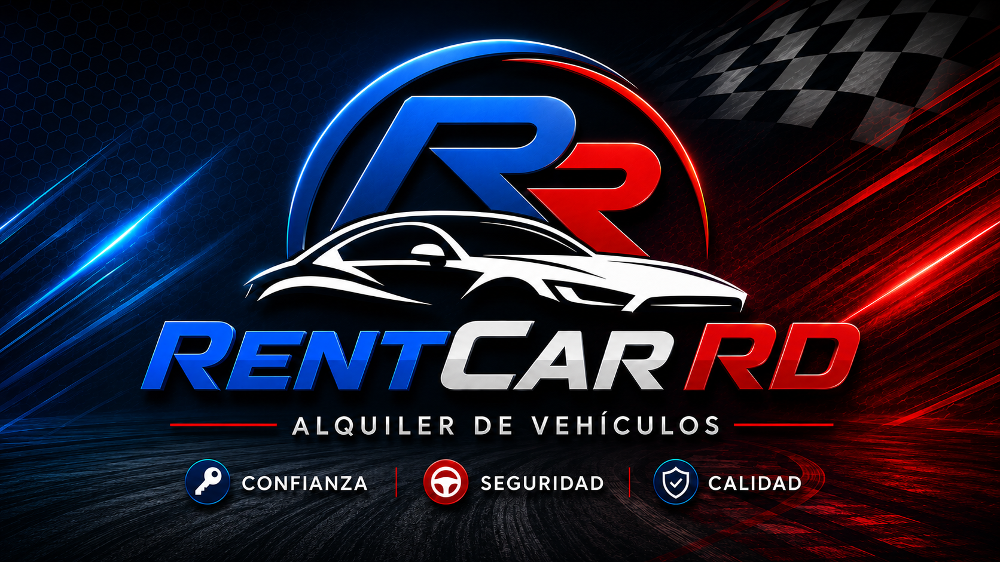

<p align="center">
  
</p>

<p align="center">
  
</p>

<p align="center">
  <strong>Aplicación web para administrar clientes, empleados, vehículos, inspecciones, rentas, devoluciones y reportes.</strong><br>
  Angular + ASP.NET Core Web API + Entity Framework Core + Microsoft SQL Server.
</p>

<p align="center">
  
  
  
  
</p>

<p align="center">
  <a href="https://github.com/Jairo0811/RentCarRD/actions/workflows/ci.yml">
    
  </a>
</p>

## 🧊 Estado final — v1.2.1 Final Quality & Security Freeze

**RentCarRD está finalizado.** La versión **1.2** fue el cierre funcional del proyecto académico; la **1.2.1** es una versión de parche de calidad y seguridad, sin funcionalidades nuevas (ver [Notas de v1.2.1](#-notas-de-v121--final-quality--security-freeze)).

A partir de esta versión el alcance funcional queda **congelado**. El repositorio entra en **maintenance mode**: únicamente se contemplan correcciones críticas de seguridad, compatibilidad o documentación; no se mantiene un roadmap de expansión funcional ni una evolución hacia SaaS dentro de este repositorio.

La edición 1.2 incorpora el hardening final del proyecto:

- configuración de frontend por entorno, sin URLs de API repetidas en los servicios;
- configuración backend portable y sin conexiones asociadas a una computadora específica;
- JWT y contraseñas con hash;
- autorización requerida por defecto;
- rate limiting global y específico para autenticación;
- CORS configurable y validación de HTTPS en producción;
- HSTS y cabeceras HTTP de seguridad;
- endpoint público `GET /health`;
- secretos de desarrollo mediante .NET User Secrets;
- pipeline CI para backend y frontend;
- Dependabot para NuGet, npm y GitHub Actions.

La edición 1.2.1 corrige defectos detectados en la auditoría final (inicio de sesión, cierre de sesión, permisos, atribución de rentas, datos de pago, concurrencia, imágenes, migraciones, indicadores y reportes) e incorpora pruebas automatizadas de backend y frontend.

> **Propósito:** proyecto académico y pieza de portafolio full-stack. No se presenta como producto SaaS comercial listo para operar sin adaptación adicional.

---

## 📖 Descripción

**RentCarRD** es una aplicación web orientada a la gestión operativa de empresas de alquiler de vehículos.

Centraliza clientes, empleados, flota, catálogos, inspecciones, rentas y devoluciones. Aplica reglas de negocio para controlar la disponibilidad de vehículos, incorpora validaciones dominicanas de cédula y RNC, calcula importes de renta e ITBIS y genera contratos y reportes en PDF y Excel.

## 🎓 Información académica

| Información | Detalle |
|---|---|
| 👨‍🎓 Estudiante | **Francis Jairo Matías Rosario** |
| 🆔 Matrícula | **A00115261** |
| 📖 Asignatura | **Desarrollo de Software con Tecnología Open Source 2 (ISO-715)** |
| 👨‍🏫 Profesor | **Juan Pablo Valdez Reyes** |
| 🏫 Institución | **Universidad APEC (UNAPEC)** |
| 📅 Período académico | **Mayo - Agosto 2026** |
| 📦 Edición final | **v1.2 Portfolio Edition** · parche **v1.2.1** |

---

## 🧭 Continuidad académica

RentCarRD fue desarrollado como proyecto académico individual por **Francis Jairo Matías Rosario (A00115261)**.

### 👨‍🏫 Continuidad por profesor

El profesor efectivo de **Desarrollo de Software con Tecnología Open Source 2 (ISO-715)** fue **Juan Pablo Valdez Reyes**. En el período académico siguiente, **Septiembre - Diciembre 2026**, el mismo profesor aparece al frente de [**SOAForge**](https://github.com/Jairo0811/SOA-Forge), correspondiente a **Integración de Aplicaciones con Tecnología Propietaria (ISO-810)**, y de [**BonitaSoft**](https://github.com/Jairo0811/BonitaSoft), correspondiente a **Integración de Aplicaciones con Tecnología Open Source (ISO-815)**.

| Orden | Asignatura | Proyecto | Período |
|---:|---|---|---|
| 1 | Desarrollo de Software con Tecnología Open Source 2 (ISO-715) | **RentCarRD** | Mayo - Agosto 2026 |
| 2 | Integración de Aplicaciones con Tecnología Propietaria (ISO-810) | [**SOAForge**](https://github.com/Jairo0811/SOA-Forge) | Septiembre - Diciembre 2026 |
| 3 | Integración de Aplicaciones con Tecnología Open Source (ISO-815) | [**BonitaSoft**](https://github.com/Jairo0811/BonitaSoft) | Septiembre - Diciembre 2026 |

SOAForge y BonitaSoft pertenecen al mismo período académico, pero a **asignaturas distintas**. SOAForge es exclusivamente **ISO-810** y BonitaSoft exclusivamente **ISO-815**.

Esta relación es **docente, formativa y cronológica**; no implica dependencia técnica entre RentCarRD, SOAForge y BonitaSoft.

### 📄 Continuidad por origen del enunciado académico

RentCarRD comparte con [**MediCore**](https://github.com/Jairo0811/MediCore) y [**CineGest**](https://github.com/Jairo0811/CineGest) un origen documental común: los tres problemas de negocio derivan de enunciados de Proyecto Final de Universidad APEC elaborados por Juan Pablo Valdez Reyes en 2020.

| Enunciado académico de 2020 | Evolución en el portafolio |
|---|---|
| Dispensario Médico | [**MediCore**](https://github.com/Jairo0811/MediCore) |
| Sistema de Video Club | [**CineGest**](https://github.com/Jairo0811/CineGest) |
| Sistema de Rentcar | **RentCarRD** |

Esta segunda relación se documenta como **continuidad por origen del enunciado académico**, distinta de la continuidad por profesor efectivo de las asignaturas cursadas.

---

## 🧱 Stack tecnológico

### 🎨 Frontend

<p>
  
  
  
</p>

- **Angular 21**
- **TypeScript 5.9**
- HTML5 y CSS3
- Bootstrap 5
- SweetAlert2
- jsPDF + jsPDF AutoTable
- ExcelJS para exportación de reportes `.xlsx`

### ⚙️ Backend

<p>
  
  
  
</p>

- **.NET 10**
- **ASP.NET Core Web API**
- C#
- Entity Framework Core
- JWT Bearer Authentication
- PasswordHasher
- Swagger / OpenAPI
- ASP.NET Core Rate Limiting
- xUnit + `WebApplicationFactory` (pruebas de integración contra SQL Server)

### 🗄️ Datos y herramientas

<p>
  
  
</p>

- Microsoft SQL Server
- Migraciones de Entity Framework Core
- npm y Angular CLI
- Visual Studio / Visual Studio Code
- Git + GitHub
- GitHub Actions
- Dependabot

---

## 🏗️ Arquitectura

```text
┌──────────────────────────┐
│ Angular + TypeScript     │
│ Frontend SPA             │
└────────────┬─────────────┘
             │ HTTPS / JSON + JWT
             ▼
┌──────────────────────────┐
│ ASP.NET Core Web API     │
│ Auth + reglas de negocio │
└────────────┬─────────────┘
             │ Entity Framework Core
             ▼
┌──────────────────────────┐
│ Microsoft SQL Server     │
│ Persistencia             │
└──────────────────────────┘
```

El frontend utiliza archivos `environment` de Angular para resolver la URL de la API según el entorno. En producción puede utilizar una API servida bajo el mismo origen (`apiBaseUrl: ''`) o adaptarse al host correspondiente.

---

## ✨ Funcionalidades

### 📊 Dashboard ejecutivo

- Indicadores de flota y clientes.
- Vehículos disponibles, rentados y no disponibles (según `EstadoOperacion`).
- Rentas activas y concluidas.
- Importe contratado (subtotal + ITBIS de los contratos). No representa cobros: RentCarRD no tiene módulo de pagos.
- Últimas rentas.
- Vehículos agregados recientemente.
- Accesos rápidos a módulos principales.

### 👤 Clientes

- CRUD de clientes.
- Persona física y jurídica.
- Validación de cédula dominicana y RNC.
- Prevención de documentos duplicados.
- Límite de crédito y restricciones de valores inválidos.
- Método de pago **simulado**: marca y 4 dígitos ficticios de referencia. No se solicita, transmite ni almacena número completo de tarjeta, titular, expiración ni CVV.

### 👨‍💼 Empleados y acceso

- CRUD administrativo de empleados.
- Activación e inactivación.
- Usuario único y validación de cédula.
- Porcentaje de comisión y tanda laboral.
- Contraseñas almacenadas mediante `PasswordHasher`.
- Inicio de sesión con JWT.
- Roles `Admin` y `Empleado`.
- Asociación del empleado autenticado con las operaciones de renta.

### 🚗 Vehículos

- CRUD de vehículos.
- Carga y vista previa de imágenes JPG, PNG y WebP.
- Búsqueda por descripción, marca, modelo, placa, chasis, motor, tipo, combustible y estado.
- Validaciones de placa y chasis.
- Prevención de duplicados.
- Estados `Disponible`, `Rentado` y `NoDisponible`.

### 📚 Catálogos

- Marcas.
- Modelos relacionados con marcas.
- Tipos de vehículos.
- Tipos de combustible.

### 🔍 Inspecciones

- Registro de inspecciones asociado a cliente y vehículo (solo `Admin`); el inspector se toma de la sesión.
- Gomas, cristales, repuesto y gato hidráulico.
- Nivel de combustible.
- Ralladuras y observaciones.

### 🔑 Rentas

- Registro de contratos de renta.
- Selección de cliente activo y vehículo disponible.
- Asociación del empleado autenticado, tomada del JWT en el servidor (no del formulario).
- Tarifa diaria y cantidad de días.
- Cálculo de subtotal, ITBIS de 18 % y total.
- Fecha prevista de devolución (fecha de renta + días).
- Bloqueo de vehículos no disponibles.
- Cambio automático del estado de la flota.
- Contrato PDF.

### 🔄 Devoluciones

- Cierre de la renta, con confirmación y protección contra doble procesamiento.
- Fecha real de devolución (fecha de calendario de República Dominicana).
- Cambio del vehículo a `NoDisponible`.
- Conservación del historial de la operación.

### 📄 Reportes

- Contrato de renta en PDF.
- Reporte general en PDF.
- Exportación `.xlsx`.
- Filtros por fecha, cliente, vehículo y estado.
- Subtotal, ITBIS y total contratado.
- La empresa, su RNC, dirección, teléfono y correo que aparecen en contratos y reportes son **ficticios** y así se indica en cada documento.

---

## 📏 Reglas de negocio

| Regla | Comportamiento |
|---|---|
| Disponibilidad | Solo se renta un vehículo `Disponible`, a un cliente activo. |
| **Sin re-renta (regla académica)** | Un vehículo que ya tuvo una renta —activa o concluida— no vuelve a rentarse; al devolverse queda `NoDisponible` y no puede volver a `Disponible`. Se conserva tal como en v1.2 (ver nota). |
| Importes | Subtotal = tarifa × días; ITBIS académico = 18 % del subtotal; total = subtotal + ITBIS. Cada importe se redondea a 2 decimales con redondeo comercial (mitades hacia arriba), igual en API y frontend. Tarifa: RD$ 0.01–1,000,000; días: 1–365. |
| Fechas | `FechaRenta` la indica el usuario; `fechaDevolucionPrevista` = fecha de renta + días (calculada); `FechaDevolucion` es la fecha **real** en que se procesa la devolución. En rentas concluidas con v1.2, `FechaDevolucion` contiene la fecha prevista (así la guardaba esa versión); no se modifica porque la fecha real nunca se registró. |
| Concurrencia | Dos solicitudes simultáneas no pueden rentar el mismo vehículo ni devolver dos veces la misma renta: token de concurrencia optimista e índice único filtrado (una renta activa por vehículo). La solicitud perdedora recibe `409`. |
| Historial | Las rentas no se eliminan. Clientes, empleados, vehículos y catálogos con registros relacionados no se eliminan (`409`); se inactivan. |

> **Nota sobre la regla de no re-renta:** no fue posible consultar el enunciado académico original durante la auditoría v1.2.1. La regla se mantiene sin cambios porque así estaba implementada y documentada en v1.2; si el enunciado no la exige, su eliminación es un cambio funcional que requiere aprobación.

## 👥 Roles y permisos

La autorización se aplica en la API; la navegación del frontend solo la refleja.

| Módulo | Admin | Empleado |
|---|:---:|:---:|
| Dashboard y reportes | ✅ | — |
| Empleados | ✅ | — |
| Vehículos (alta, edición, imágenes, eliminación) | ✅ | Consulta (necesaria para rentar) |
| Inspecciones | ✅ | — |
| Rentas y devoluciones | ✅ | ✅ |
| Clientes | ✅ | ✅ |
| Catálogos (marcas, modelos, tipos) | ✅ | ✅ (como en v1.2) |
| Perfil propio (`GET /api/auth/me`) | ✅ | ✅ |

Una cuenta inactivada pierde el acceso en la siguiente solicitud aunque su token no haya expirado. La cuenta `admin` no puede renombrarse, inactivarse ni eliminarse.

---

## 🔐 Seguridad de la edición 1.2

La API aplica autenticación de manera predeterminada. Los endpoints públicos se limitan a:

- `POST /api/auth/login`
- `GET /health`

Controles implementados:

- JWT firmado con validación de issuer, audience, firma y expiración.
- Contraseñas con hash mediante ASP.NET Core Identity `PasswordHasher`.
- Administración de empleados restringida al rol `Admin`.
- Rate limiting global por IP.
- Rate limiting reforzado para el login.
- CORS definido mediante configuración.
- Producción restringida a orígenes HTTPS.
- HSTS fuera de Development.
- Redirección HTTPS.
- `X-Content-Type-Options: nosniff`.
- `X-Frame-Options: DENY`.
- `Referrer-Policy: no-referrer`.
- `Permissions-Policy` restrictiva.
- JWT y contraseña bootstrap fuera del repositorio.

Añadido en 1.2.1:

- Identidad del empleado responsable tomada del claim firmado `empleado_id` (sin suplantación desde el JSON).
- Validación del empleado (existe, activo, rol vigente) en cada solicitud autenticada.
- DTOs de entrada y salida en todos los controladores (sin sobreasignación; nunca se devuelven hashes).
- Imágenes: firma binaria, análisis estructural del formato real, límites de tamaño y dimensiones, eliminación de metadatos (EXIF/GPS, XMP, ICC…), nombres generados por el servidor y ruta nunca aceptada desde el cliente.
- Errores de SQL Server (duplicados, integridad, concurrencia) traducidos a `409`/`400` con `ProblemDetails`.
- Frontend: JWT solo en `sessionStorage` y solo enviado a la API de RentCarRD; cierre de sesión completo; guards por rol.

La guía completa está en [`SECURITY_SETUP.md`](SECURITY_SETUP.md).

---

## 📂 Estructura

```text
RentCarRD/
├── .github/
│   ├── dependabot.yml
│   └── workflows/
│       └── ci.yml
├── RentCar.API/
│   ├── RentCar.API/
│   │   ├── Auth/
│   │   ├── Controllers/
│   │   ├── Domain/            # reglas: cálculo de renta, documentos, constantes
│   │   ├── Dtos/
│   │   ├── Infrastructure/    # imágenes, errores de BD, fecha de negocio
│   │   ├── Migrations/
│   │   ├── Models/
│   │   ├── Properties/
│   │   ├── wwwroot/
│   │   ├── Program.cs
│   │   └── appsettings.json
│   └── RentCar.API.Tests/     # xUnit: unitarias + integración con SQL Server
├── RentCarClient/
│   ├── public/
│   ├── scripts/audit-gate.mjs
│   ├── security/npm-audit-exceptions.json
│   ├── src/
│   │   ├── app/
│   │   │   ├── components/
│   │   │   ├── interfaces/
│   │   │   ├── services/
│   │   │   └── shared/        # alertas, fechas, montos, documentos, contrato PDF
│   │   └── environments/
│   ├── angular.json
│   └── package.json
├── docs/
│   └── BASE_DE_DATOS.md
├── RentCarDB.sql              # histórico; el esquema se crea con migraciones
├── SECURITY_SETUP.md
└── README.md
```

---

## 🚀 Ejecución local

### Requisitos

- .NET SDK 10
- Node.js compatible con Angular 21
- npm
- Microsoft SQL Server o SQL Server LocalDB

### 1. Clonar

```bash
git clone https://github.com/Jairo0811/RentCarRD.git
cd RentCarRD
```

### 2. Configurar el backend

```bash
cd RentCar.API/RentCar.API
dotnet restore
dotnet user-secrets set "Jwt:Key" "<secreto-aleatorio-de-32-o-mas-caracteres>"
dotnet ef database update
dotnet run --launch-profile https
```

`dotnet ef database update` crea el esquema completo en una base vacía. **Antes de migrar una base existente, haga un respaldo**: la migración v1.2.1 reduce los números de tarjeta históricos a 4 dígitos de forma irreversible y se detiene si encuentra datos que violan las nuevas restricciones. Consulte [`docs/BASE_DE_DATOS.md`](docs/BASE_DE_DATOS.md).

En Development se utiliza por defecto SQL Server LocalDB con la base `RentCarDB`. Para otra instancia, sobrescriba `ConnectionStrings:DefaultConnection` mediante User Secrets o variables de entorno.

API de desarrollo:

```text
https://localhost:7162
```

Swagger:

```text
https://localhost:7162/swagger
```

Health check:

```text
https://localhost:7162/health
```

### 3. Configurar el administrador inicial

Defina temporalmente la contraseña inicial (y, si la base es nueva y no existe `admin`, una cédula válida para crearlo):

```powershell
$env:RENTCARRD_BOOTSTRAP_ADMIN_PASSWORD = "<contraseña-de-12-o-mas-caracteres>"
$env:RENTCARRD_BOOTSTRAP_ADMIN_CEDULA = "<cédula-dominicana-válida>"   # solo base nueva
dotnet run --launch-profile https
Remove-Item Env:RENTCARRD_BOOTSTRAP_ADMIN_PASSWORD, Env:RENTCARRD_BOOTSTRAP_ADMIN_CEDULA
```

Nunca sobrescribe una contraseña existente. No hay credenciales por defecto en el repositorio.

### 4. Ejecutar Angular

En otra terminal:

```bash
cd RentCarClient
npm ci
npm start
```

Aplicación:

```text
http://localhost:4200
```

Angular utiliza automáticamente `environment.development.ts`, configurado contra `https://localhost:7162`.

---

## 🧪 Validación automatizada

GitHub Actions ejecuta en cada pull request y en cada push a `main` (acciones fijadas por SHA, permisos `contents: read`):

**Backend**

- `dotnet restore` con auditoría NuGet (vulnerabilidades moderadas o superiores = error)
- `dotnet build --configuration Release`
- `dotnet list package --vulnerable --include-transitive` (falla ante paquetes vulnerables)
- `dotnet test`: pruebas unitarias e integración de la API completa contra un contenedor SQL Server aislado (roles, suplantación, concurrencia, devoluciones, ITBIS, imágenes, errores SQL y migración de una base histórica con datos sensibles)
- `dotnet ef migrations has-pending-model-changes` y script de migración idempotente

**Frontend**

- `npm ci`
- `npm run audit:gate`: cero vulnerabilidades en dependencias de producción; las altas/críticas del toolchain solo se admiten con excepción documentada y fecha de revisión (`security/npm-audit-exceptions.json`)
- `npm run build`
- `npm run test:ci` (Vitest: sesión, guards, interceptor, rentas, clientes, dashboard, reportes y Excel, contrato PDF, catálogos, login)

Ejecución local de las pruebas del backend (requiere SQL Server; por defecto usa LocalDB):

```powershell
$env:RENTCARRD_TEST_SQL = "Server=localhost,1433;User Id=sa;Password=<...>;TrustServerCertificate=True"  # opcional
dotnet test RentCar.API/RentCar.API.slnx
```

Dependabot revisa semanalmente dependencias NuGet, npm y GitHub Actions.

---

## ✅ Estado del proyecto

| Área | Estado |
|---|:---:|
| Dashboard | ✅ Finalizado |
| Clientes | ✅ Finalizado |
| Empleados | ✅ Finalizado |
| Vehículos | ✅ Finalizado |
| Catálogos | ✅ Finalizado |
| Inspecciones | ✅ Finalizado |
| Rentas y devoluciones | ✅ Finalizado |
| Contratos PDF | ✅ Finalizado |
| Reportes PDF / Excel | ✅ Finalizado |
| Cédula y RNC | ✅ Finalizado |
| JWT y hash de contraseñas | ✅ Finalizado |
| Configuración por entorno | ✅ Finalizado |
| Hardening HTTP / rate limiting | ✅ Finalizado |
| CI y Dependabot | ✅ Integrado |
| Pruebas automatizadas (API + Angular) | ✅ v1.2.1 |
| Entrega académica | ✅ Completada |
| Desarrollo funcional | 🧊 Congelado |
| Estado de mantenimiento | 🔒 Correcciones críticas únicamente |

---

## 🧪 Flujo manual recomendado

1. Iniciar sesión como administrador (y, en otra sesión, como empleado para comprobar permisos).
2. Verificar catálogos.
3. Registrar un empleado.
4. Registrar clientes físico y jurídico.
5. Registrar un vehículo con imagen.
6. Crear una inspección.
7. Registrar una renta.
8. Verificar subtotal, ITBIS y total.
9. Confirmar el cambio del vehículo a `Rentado`.
10. Generar contrato PDF y reporte Excel/PDF.
11. Procesar la devolución.
12. Confirmar renta `Concluida` y vehículo `NoDisponible`.

---

## 🩹 Notas de v1.2.1 — Final Quality & Security Freeze

Versión de parche: corrige defectos sin ampliar el alcance funcional.

- **Inicio de sesión**: `POST /api/auth/login` respondía `500` en v1.2 (atributos de validación mal declarados en un *record*).
- **Cierre de sesión**: ahora elimina el JWT de `sessionStorage`; antes solo limpiaba `localStorage`.
- **Permisos**: guards por rol; la API exige `Admin` para vehículos, imágenes, inspecciones y empleados (en v1.2 solo la interfaz lo ocultaba).
- **Rentas**: el empleado responsable se toma del token; el rol Empleado ya no recibe `403` al abrir Rentas; sin doble alquiler ni doble devolución bajo concurrencia.
- **Datos de pago**: solo marca + 4 dígitos ficticios; los históricos se reducen a 4 dígitos en la migración.
- **Inspecciones**: los neumáticos no se guardaban (nombres de campo distintos entre frontend y API).
- **Dashboard y reportes**: estados operativos reales e importe contratado con ITBIS; Excel con fechas y números reales.
- **Base de datos**: `dotnet ef database update` funciona en una base vacía; la migración de v1.2 que nunca se aplicaba ahora es descubrible; restricciones de integridad.
- **Dependencias**: parches de ASP.NET Core/EF Core 10.0.15 y Angular 21.2; `npm audit --omit=dev` y NuGet sin vulnerabilidades.

## 🧊 Política de mantenimiento

La **v1.2 Portfolio Edition** es la última versión funcional planificada de RentCarRD; la **v1.2.1** es su parche final de calidad y seguridad.

Se consideran cambios posteriores únicamente cuando sean necesarios para:

- corregir una vulnerabilidad crítica;
- restaurar compatibilidad con una dependencia o plataforma;
- corregir un defecto que impida ejecutar la versión documentada;
- preservar o mejorar documentación técnica sin ampliar el dominio funcional.

No forman parte del alcance futuro de este repositorio reservas online, pagos comerciales, multi-tenancy, facturación fiscal, aplicaciones móviles ni otros módulos orientados a convertirlo en SaaS.

---

## 👨‍💻 Autor

**Francis Jairo Matías Rosario**

- 🎓 Universidad APEC (UNAPEC)
- 📚 Ingeniería de Software
- 🆔 Matrícula: **A00115261**
- 💼 Proyecto académico y de portafolio profesional

---

<p align="center">
  <strong>RentCarRD v1.2.1 — Final Quality & Security Freeze</strong><br>
  Desarrollo funcional finalizado · Maintenance mode
</p>